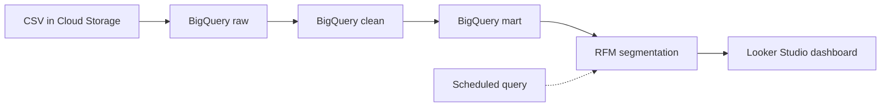
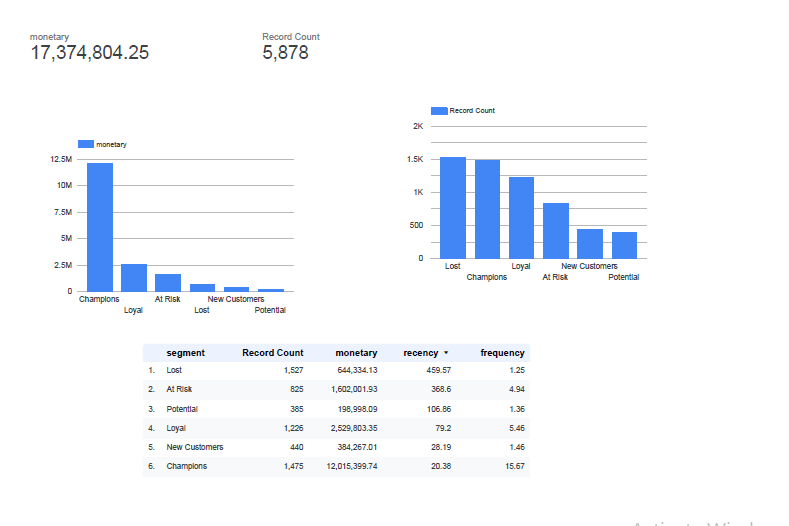
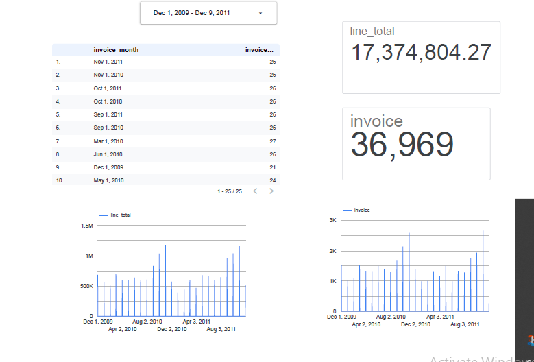

# Retail Customer Segmentation Pipeline on GCP

End-to-end data pipeline that loads retail transactions, cleans and models them in BigQuery, segments customers with RFM analysis, and serves a Looker Studio dashboard.

## Architecture



## Tech stack
Google Cloud Storage, BigQuery (SQL), BigQuery scheduled queries, Looker Studio

## Dataset
UCI Online Retail II: about 1.07M transactions from a UK online retailer, Dec 2009 to Dec 2011.

## Pipeline steps
1. **Ingest:** raw CSV uploaded to Cloud Storage.
2. **Load:** loaded into `raw.online_retail` with all columns as text, so the load never fails on bad values.
3. **Clean:** `clean.sales` casts types, removes missing customer IDs, cancelled invoices (start with "C"), zero or negative quantity and price, and duplicates. 1,067,371 rows reduced to 779,425.
4. **Model:** `mart.fact_sales`, `mart.dim_customer`, `mart.dim_product`, `mart.product_sales`.
5. **Analyze:** RFM scoring with `NTILE(5)` and rule-based segments.
6. **Schedule:** the RFM table is refreshed by a BigQuery scheduled query.
7. **Visualize:** two-page Looker Studio dashboard (Segments, Sales Trends).

## Key results
- 5,878 customers, 36,969 invoices, about 17.4M total revenue
- **Champions** are 1,471 customers (25%) but generate about 12M revenue (about 69%)
- **At Risk** customers (831) average 368 days since last purchase, so they are a clear win-back target
- Revenue peaks every November (holiday season)

## RFM segments
| Segment | Meaning |
|---|---|
| Champions | Bought recently and often |
| Loyal | Good recency and frequency |
| New Customers | Recent, but few orders |
| At Risk | Used to buy often, not lately |
| Lost | Long inactive, few orders |
| Potential | Everyone in between |

A fixed reference date (2011-12-10) is used instead of `CURRENT_DATE()` because the dataset is historical.

## Repo structure
```
sql/    clean, mart, and RFM queries
docs/   dashboard screenshots
```

## Dashboard


